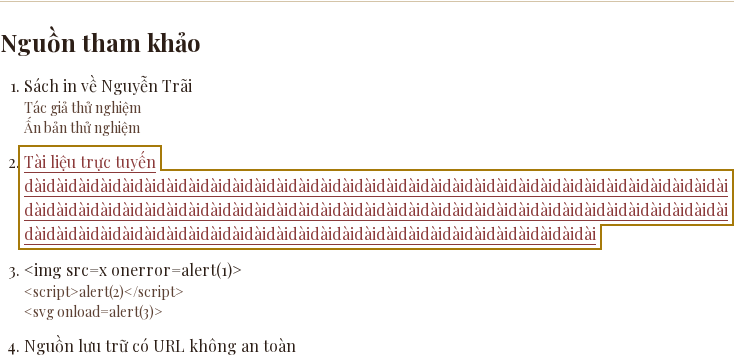
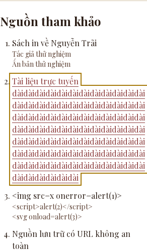
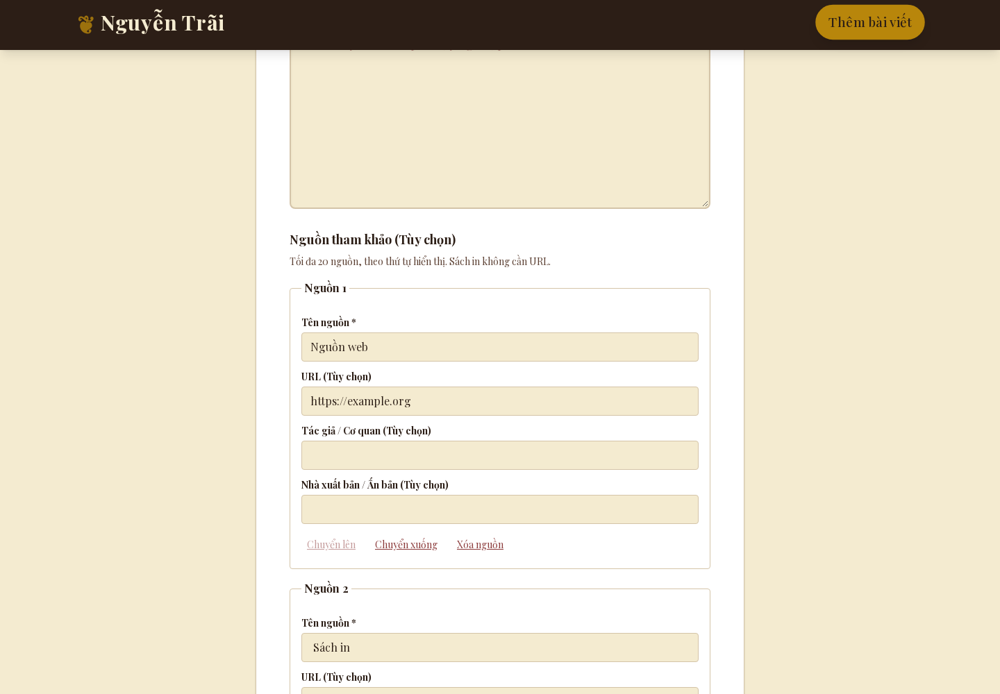
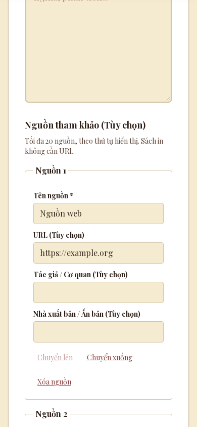

# Issue #43 — historical article references

Implementation: `55482d5` (base `82090d9`). This is a create-only addition; no
existing article prose, source data, SQL schema, provider selection or cache
policy changes. Sources are editorial input, not automatically verified facts.

## Before / after

Before: the create route stripped `references`, accepted malformed reference
payloads as unknown keys, and the public article had no sources section.
Replaying the six create-route tests against base `82090d9` produced three
expected failures: saved references absent, malformed references accepted
(`201` instead of `400`), and oversized request accepted. The three existing
validation/security tests passed.

After: optional ordered references are validated and returned by create and
product GETs; print sources work without a URL. The authenticated form supports
adding, removing and moving sources, field-specific errors, failure retention,
and focus restoration. Public detail displays “Nguồn tham khảo” after existing
content/media only when a public article has sources. React escapes all text;
unsafe stored URLs become plain text rather than links. Legacy missing status
remains public; draft/archive filtering remains in the existing data path.

The schema allows 20 references, title ≤300, URL ≤2048, author/publisher ≤200;
optional blank values are omitted. POST also bounds streamed request bodies to
1 MiB, after origin/write-pause/session/rate-limit gates, using the existing
validation-error convention. See [API contract](api.md).

## Validation

All checks used Node **24.22.1**. `npm ci` synchronized the checkout to the
committed lockfile, including Next.js **16.4.3**; no dependency files changed.

| Check | Result |
| --- | --- |
| Full `npm test` | 120 passed, 0 failed, 0 skipped |
| `npm run lint` | Passed |
| `npm run typecheck` | Passed |
| `node scripts/ui-review/build.cjs` | Production Webpack build passed |
| Production Playwright, 1440×1000 and 390×844 | Passed; zero page errors, no horizontal overflow |
| Independent review | One focus finding fixed and re-reviewed; no remaining blockers |

Regression coverage includes omitted/empty references, normalization/order,
maximum boundaries, malformed entries/URLs, dangerous protocols, HTML escaping,
UTF-8 split across streamed chunks, oversized stream cancellation, create →
Redis/JSONB adapter → public GET round-trip, legacy/media preservation, public
filtering, existing security gates, cache invalidation, and deletion recovery
including saved references. External storage I/O is mocked in these tests.

Browser checks use a real local production server with a synthetic read-only
Redis responder. Persistent writes are paused; database/provider credentials are
blanked; all external browser origins are blocked. Admin auth/save responses are
intercepted, so these are UI checks rather than live authentication/storage tests.
The checks cover books, safe web links, escaped injection strings, unsafe stored
URLs, legacy detail, private API/page behavior, field errors, keyboard
add/reorder/remove, failed-save retention, success reset, the 20-source cap and
focus restoration when removing at the cap. Playwright 1.64.0-alpha-1790635538000,
Chromium build 1247 were reused from the existing review environment.

[Browser receipt](evidence/issue43/references-browser.json) identifies the
implementation revision. Public desktop/mobile and admin desktop/mobile
screenshots are linked below. The long unbroken source title and injection text
are deliberate stress fixtures, not authored historical content.

## Independent review

A separate read-only reviewer checked the issue contract, changes since
`82090d9`, security gates, URL/text rendering, persistence/cache preservation,
form behavior, accessibility, tests and scope. It reproduced a focus bug:
removing a source when Add was disabled at 20 rows could leave focus on the body.
The correction defers focus until React commits; add/reorder also focus the
stable source title. The reviewer confirmed the correction and the new 20→19
keyboard browser regression, with no remaining blocking findings. It did not
independently execute live Neon/Redis or the full production/browser suite.

## Reproduce

From this checkout, use Node 24.22.1 and `npm ci`. Do not use production service
credentials for browser validation. The existing build harness overrides them.

```sh
npm test
npm run lint
node scripts/ui-review/build.cjs
npm run typecheck
NODE_PATH=/path/to/review-tools/node_modules UI_REVIEW_PORT=3346 UI_REVIEW_OUTPUT=/tmp/issue43-ui node scripts/ui-review/references.cjs
```

The last command starts and stops its own loopback app/responder. Playwright is
an external review tool, not a new app dependency. See the [harness setup](../scripts/ui-review/README.md)
for the pinned tool/browser installation.

## Rollback and limits

Revert the implementation commit to remove creation/display of references.
Keep existing content payloads intact: the old Product type does not erase the
optional JSON field, and no data migration or cleanup is necessary. There is no
edit-existing workflow in this change. Authored sources remain an editorial
responsibility; no scraping, AI citations, SEO or verification timestamps added.

No live Neon/Redis mutations, real media uploads, deployment or production
checks were performed. Existing unit regressions exercise media cancellation,
progress and deletion recovery. The feature branch is explicitly disabled in
`vercel.json` to prevent automatic preview deployment when opening the draft PR.
A merge or deployment still requires owner approval.

The first pre-sync build used stale installed Next.js 16.4.0 and emitted a
security-upgrade notice after compilation. After `npm ci`, the final 16.4.3 build
passed without that notice. The lockfile production audit reported zero
vulnerabilities; `npm ci` reported two moderate development-tooling advisories.
No unrelated security upgrade was included.

## Screenshots





