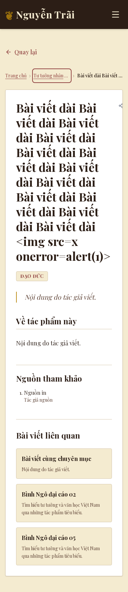
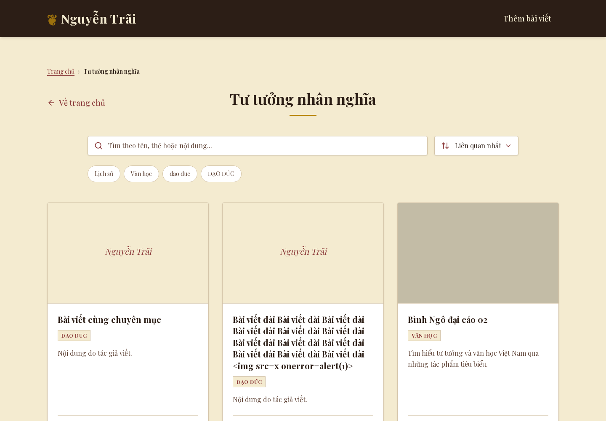

# Issue #46 — P7 reading experience

Source reviewed: `a61837bb9849` → `1770905b6fe71b82dd5a72cdb26c5455d63636db`.

## Behavior

- Section pages: visible `Trang chủ > Tên chuyên mục`; article pages: home, known section, current title. Ordered navigation, current-page marking, full accessible names, keyboard outlines and mobile truncation use the existing parchment/burgundy palette. Back, share, header, references and media remain in place.
- `articleSection` / `articleBreadcrumbs` share the configured section lookup with P6 JSON-LD. Missing/null/empty section resolves to `tu-tuong-nhan-nghia`, matching the existing section listing. Unknown names omit the middle crumb. This intentionally adds the default section to legacy Article/BreadcrumbList data; canonicals and the public-record gate are unchanged.
- Up to three related articles: same configured section first, descending count of distinct shared tags second, Vietnamese title then lexical ID last. Tags fold case, accents, `đ`, surrounding/repeated whitespace. Shared-tag articles backfill remaining places; unrelated articles never appear. Empty results omit the region.
- Current IDs, duplicate routes, nonpublic status and records rejected by P6's unchanged renderability gate are excluded. Missing status stays public. The first occurrence owns each route, matching the reader's lookup; a malformed first occurrence cannot be replaced by a later valid duplicate. Invalid image records are excluded even though compact cards render no images.
- Article content and recommendations use one `getProducts()` read. Metadata retains its existing reader; no extra independent recommendation read or per-card read, client index, dependency, schema, storage/cache policy or auth change. New links disable prefetch to avoid background article/media fetches.
- Browser checks found an existing Next 16.4.3 page-parameter incompatibility: page params use encoded segment values, unlike metadata lookup. The article page now decodes exactly once before selecting its record, rejecting malformed encoding. Spaces, Unicode, slashes and literal percent IDs remain distinct; shared `getProduct` and metadata are unchanged.

## Validation

Node **24.22.1**, Next **16.4.3**, TypeScript **5.9.3**, Playwright **1.64.0-alpha-1790635538000**, Chromium **155/build 1247**. Application dependencies and lockfile are unchanged.

| Gate | Result | Evidence |
| --- | --- | --- |
| `npm test` | 136/136 pass | [tests.txt](tests.txt) |
| `npm run lint` | pass | [checks.txt](checks.txt) |
| `npm run typecheck` | pass | [checks.txt](checks.txt) |
| Credential-isolated `node scripts/ui-review/build.cjs` | production Webpack build passes | [build.txt](build.txt) |
| Harness isolation/rejection self-tests | pass | [harness.txt](harness.txt) |
| P7, both required sizes | pass; zero page errors | [reading-browser.json](reading-browser.json) |
| P6 SEO, both sizes | pass | [seo-browser.json](seo-browser.json) |
| P5 references/admin, both sizes | pass | [references-browser.json](references-browser.json) |
| Public navigation/reduced motion | pass | [public-browser.json](public-browser.json) |
| Public search/filter/navigation | pass; zero retired/provider search requests | [search-browser.json](search-browser.json) |
| Independent standards and spec reviews | no blocking findings | [review.md](review.md) |

P7 assertions cover JSON-LD/visible crumb names and ancestor paths, known/default/unknown sections, full accessible names despite truncation, visible focus, Enter/Tab navigation to section/home/related article, real URL identity, encoded/literal-percent routes, 1/3 card columns, current/self/unique/max-three links, no media/embeds in cards, empty/backfill results, XSS escaping, references/canonical preservation, reduced motion, no horizontal overflow, and missing/malformed/draft/archived pages without breadcrumbs/recommendations/JSON-LD and with noindex. Unit coverage adds duplicate IDs, invalid images, empty/single-item datasets, accent/case folding, stable tie breaks and maximum-three ranking.

Screenshots were visually inspected at **390×844** and **1440×1000**, including the breadcrumb focus outline, title truncation, stacked/three-column cards and preserved reference UI. Before, P6 source contained structured breadcrumbs only and no related module; after, the regions are visible and the checks above pass. One early synthetic browser dataset duplicated an ID and triggered the existing MiniSearch section/home index error; the navigation fixture now uses unique records, while duplicate recommendation rejection stays unit-tested. That unrelated search-index limitation is not changed here.





Other captured views: [desktop article](reading-article-1440.png), [mobile related cards](reading-related-390.png), [mobile section](reading-section-390.png).

## Reproduction

Use the existing external review-tool installation described in [scripts/ui-review/README.md](../../../scripts/ui-review/README.md); no application dependency installation is added. Run from the repository root with Node 24.22.1 and `NODE_PATH` pointing to that tool installation.

```sh
npm test
npm run lint
npm run typecheck
node --test scripts/ui-review/harness.test.cjs
node scripts/ui-review/build.cjs
UI_REVIEW_PORT=3360 UI_REVIEW_OUTPUT=/tmp/p7-ui node scripts/ui-review/reading.cjs
UI_REVIEW_PORT=3362 UI_REVIEW_OUTPUT=/tmp/p7-seo node scripts/ui-review/seo.cjs
UI_REVIEW_PORT=3364 UI_REVIEW_OUTPUT=/tmp/p7-references node scripts/ui-review/references.cjs
```

For the existing public/search suites, start `UI_REVIEW_PORT=3366 node scripts/ui-review/server.cjs` separately, run both `public.cjs` and `search.cjs` with that same port, then stop it. All harnesses use synthetic Redis GET responses and blank real storage/provider credentials. They pause writes, reject unsupported storage commands, and browser suites abort nonlocal requests. Build startup verifies only persistence identity with Redis selected and no real credentials. Local servers were stopped after validation.

Receipts record the source revision at capture; the final P7/SEO/reference/public/search receipts use `1770905`. The final evidence-only commit does not change tested application code. Generated Next type imports/build-info were restored or removed, and the pre-existing untracked `.vercel/` directory was left untouched.

## Rollback and limits

This is a reversible public-rendering change. Before merge, close the draft PR. After a separately approved release, revert this PR's merge commit on a new branch, run tests/lint/typecheck/build, review, then request release approval. No data restoration, migration or cache flush is needed. Keep the existing branch deployment-disable entry until a deployment is explicitly authorized.

`feat/p7-reading-experience` is explicitly disabled in `vercel.json` Git deployments before push. No merge, deployment, production content mutation, AI recommendation request, new service or dependency was performed. Automatic TOC generation remains deferred. No live Neon/Redis/provider integration or field-vitals measurement is claimed; #39/#40 and Search Console ownership remain separate. Existing search listings can still reject duplicate stored IDs; this PR guarantees deduplication within recommendations only.
