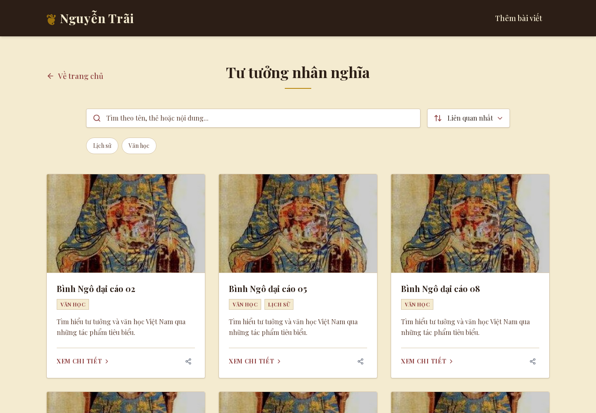

# Integrated UI review — 2026-10-22

Main `cbf43ec` includes roadmap #29 and P2 #31. P1 #30 and P3 #32 were merged into `review-ui-p0-foundation` (`6dd1149`), not main. The draft `review-ui-roadmap-integration` combines that stack with current main. One integration PR avoids duplicating already-merged focused reviews. No merge to main, deployment, environment change or production mutation was performed in this preparation.

## Independent review sections

- **P0 prerequisites:** browser-local MiniSearch and complete AI-summary UI/API removal. Review `lib/product-search.ts`, `components/ProjectList.tsx`, removed endpoints/components and their regression tests separately. Authored descriptions, media and AI title suggestions remain intact. Pending original P0 branches are preserved. [Conflict evidence](p0-compatibility.md).
- **P1 public polish:** spacing, card/media layout, reduced motion, native mobile navigation and darker keyboard outlines. [Original focused review #30](https://github.com/Kiy-K/NguyenTrai-Porfolio/pull/30), [validation](../../ui-p1-public-validation.md). Runtime source differs from `b862a2f` only in `app/globals.css` for the reviewed focus correction.
- **P2 admin:** already on main via [#31](https://github.com/Kiy-K/NguyenTrai-Porfolio/pull/31); no admin runtime or admin test diff against main. [Validation](../../ui-p2-admin-validation.md). Fresh integration browser checks exercise pending/rejected/offline/accepted authentication and mocked media/save/delete/recovery flows.
- **P3 evidence:** [historical full report](../../ui-p3-a11y-performance.md), [portable harness](../../../scripts/ui-review/README.md), and fresh results below. No infrastructure or P4 implementation.

## Fresh verification

Measured application revision: `45f36ada95e70ed7cbcba1f1e857513150930287`. Later changes only update evidence, documentation and the harness metadata self-test. Node 26.10.0, pinned Playwright/Chromium and Lighthouse versions from the reproduction guide. Synthetic content only, writes paused, service credentials blank; browser mutations intercepted. No claim of Node 24 deployment-runtime parity.

- **100/100** integrated regression tests; lint, typecheck and credential-isolated webpack production build pass. [Command output and exit statuses](results/integration-checks.txt).
- Harness **2/2** tests, including receipt runtime/source metadata; final lint passes. [Harness output](results/integration-harness-checks.txt), [lint output](results/integration-final-lint.txt).
- Public, offline search, admin, screenshots and vitals scripts all exit zero. [Browser command output](results/integration-browser-checks.txt). The five previously incomplete `reproduction-*.json` receipts were regenerated from the committed writer, rather than manually patched. Each records Node version, revision, UTC time and loopback origin.
- [Public receipt](results/reproduction-public-browser.json), [search receipt](results/reproduction-search-browser.json), [admin receipt](results/reproduction-admin-browser.json), [screenshots](results/reproduction-screenshots-after.json), [vitals](results/reproduction-vitals-after-quiet.json).

| Section lab profile | LCP ms | CLS | Page-lifetime INP ms |
| --- | ---: | ---: | ---: |
| Desktop 1440×1000 | 232 | 0 | 40 |
| Mobile 390×844 | 204 | 0 | 8 |

These single-run samples differ from historical values; runtime/toolchain/load are not a controlled comparison. Desktop timing increased relative to the old quiet sample, while mobile INP decreased. No speedup or statistically established regression follows; field metrics and matched repeated measurements remain required for performance claims.

### Fresh Lighthouse performance gate

The [first run](results/integration-lighthouse-first.json) scored **83 mobile / 100 desktop**; the [quiet repeat](results/integration-lighthouse-repeat.json) scored **84 / 100**, with accessibility **96** throughout. Mobile TBT was **665.5 / 609.2 ms**, above the historical 202–268 ms. CLS remained zero. The lower mobile score persisted on this machine, so it is an **unresolved release gate**, not dismissed as a single outlier. The live third-party widget and Node/toolchain/date differences prevent attribution to this code without a matched baseline. Run matched baseline/current measurements under the intended runtime and investigate blocking work before performance sign-off. No new performance fix is asserted here.

## Visual evidence

Original before screenshots remain unchanged. Fresh integrated after screenshots use the same synthetic fixture and viewports. Historical baseline already includes P0, so these illustrate P1 polish rather than the AI-removal transition.

| Before | Integrated after |
| --- | --- |
|  |  |
|  |  |

[All public and admin screenshots](screenshots/) include both viewport sizes and fresh admin confirmation captures. [Original P2 before/after gallery](../../ui-p2-admin-validation.md) remains available.

## Release gates, limits and rollback

1. Explicitly accept the included P0 behavior/removals; do not merge the historical P0b branch blindly over its already-resolved source. Six original documentation conflicts remain documented; current-main integration itself is conflict-free.
2. Require fresh PR CI and independent review of the combined diff. Recheck base drift before merge and rerun affected checks if main changes.
3. Obtain owner approval before merge or release. The exact review branch has automatic Git deployment disabled; main deployment behavior is unchanged. Reverting the scoped code requires a rebuild, with no content/media migration.
4. After an approved release, perform read-only route/CDN checks and collect field metrics. Historical CDN MISS receipts do not prove the new release or internal Redis hit rate.

Existing ElevenLabs attribution contrast remains **2.06–2.1:1 against 4.5:1**, with historical Lighthouse accessibility 96. App-owned focus contrast is corrected. Chromium only; Firefox/Safari, manual screen-reader audit, live Cloudinary/Mux uploads and external video playback remain unverified. The stale AI-title response race predates this work and is unchanged. Historical dependency audit found unchanged development advisories and zero production advisories; it was not refreshed in this preparation.

P4 remains deferred: no TanStack Query, hosted search, Redis cleanup or speculative dependency work. Original `perf/a11y-audit` stays at `b862a2f`; the untracked `.vercel/` directory and managed admin checkout are preserved.
