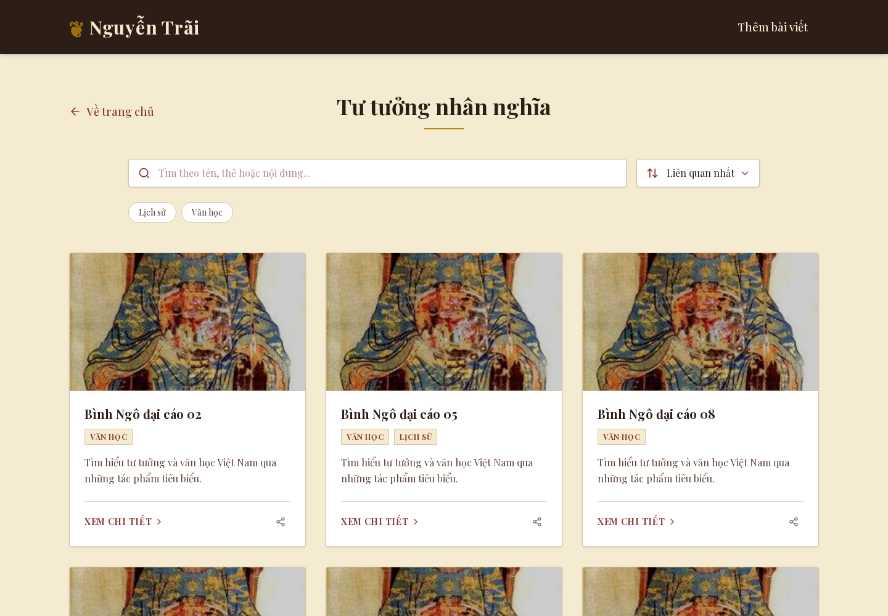
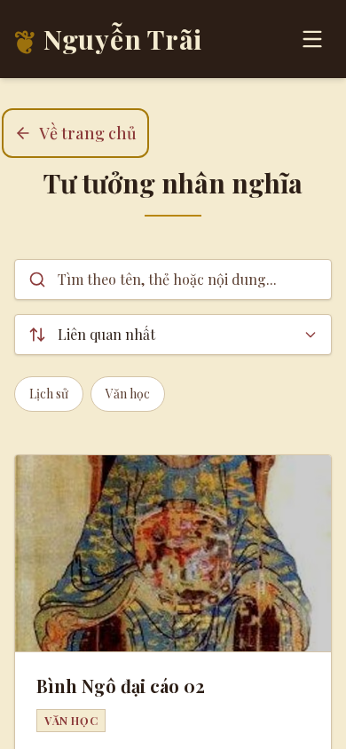
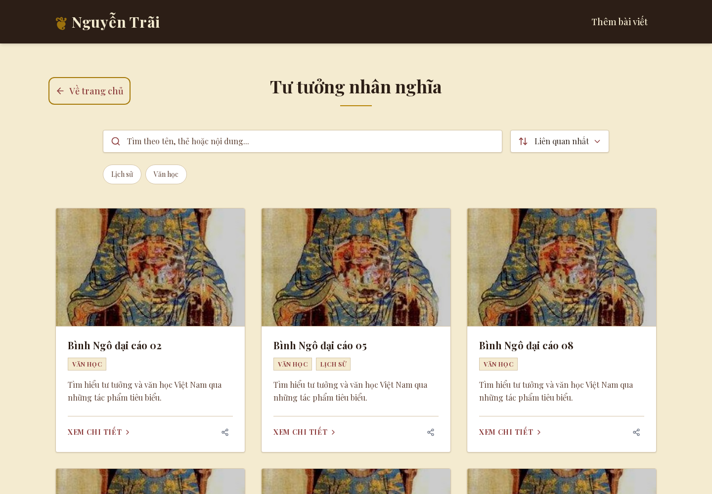

# P1 public polish — local validation, 2026-10-17

Branch: `ui/public-polish`, stacked on reviewed P0 search and summary-removal changes. The original independent P0 branches remain available. The source commits were validated locally; this review branch is now published as a draft. No main merge, release, environment change or production write.

## Changes

- Preserve Vietnamese copy, historical imagery, Playfair typography and parchment/gold/burgundy colors. Reduce mobile hero/section padding and long entrance delays; keep a single short hero entrance. Add explicit hero image sizes/preload for the existing above-the-fold portrait.
- Use a consistent 16:10 card image frame, readable wrapped titles and faster hover transitions. Match the existing skeletons to the new image frame, summary-free cards and mobile page spacing.
- Replace the offscreen mobile drawer with a labelled native modal dialog. Closed links leave the keyboard sequence; the browser handles modal focus and Escape. Closing restores focus, resizing to desktop closes the modal, and body scroll is restored. No new dependency.
- Add visible palette-matched keyboard outlines, improve search placeholder contrast, enlarge tag targets and suppress motion delays when reduced motion is requested.
- Remove the homepage's dead category Suspense boundary: CategoryLayout is a synchronous client component with no suspending read. No replacement loading system was added.

## Evidence

- 90 tests pass on the P1 snapshot, including the new mobile-dialog regression plus both P0 suites. Lint, typecheck and webpack build pass. Independent review found only loading-shell mobile spacing drift; that was corrected before handoff. Mechanical Impeccable scan returned `[]`.
- Playwright at 390×844 and 1440×1000 checks home/section/detail identity, meaningful content, no horizontal overflow or uncaught page errors, consistent card heights, native menu keyboard opening, modal Tab sequence, Escape/focus restoration, body scroll restoration, desktop resize cleanup and reduced motion. Native Chromium permits the browser-chrome tab stop between modal focus cycles; background app links remain inert.
- Screenshots were captured before/after at both sizes: `/tmp/nguyentrai-p1-{before,after}-{home,section,detail}-{390,1440}.png`, plus `/tmp/nguyentrai-p1-mobile-menu.png`. Synthetic section data uses the repository's real local portrait asset; no editorial content/media references were changed.
- Artifacts: `/tmp/nguyentrai-p1-browser.json`, `nguyentrai-p1-tests.log`, `nguyentrai-p1-lint.log`, `nguyentrai-p1-types.log`, `nguyentrai-p1-build.log`, `nguyentrai-p1-design-scan.json`.

Harness: `/tmp/nguyentrai-p1-browser.cjs`, using the synthetic read-only app at `http://127.0.0.1:3330` and existing cached Playwright. External browser traffic is blocked. The Browser plugin runtime described by the frontend testing skill is not installed. Performance/accessibility measurements are recorded separately in `docs/ui-p3-a11y-performance.md` on the downstream audit branch.

Scope limits: embedded-media playback and real provider uploads were not exercised. Shared media rendering and providers remain unchanged. Native dialog behavior was tested in Chromium; Safari/Firefox are not claimed verified. Reverting the scoped UI commit requires no data migration; release/rollback still requires owner approval.

## GitHub review evidence

Review head: `review-ui-public-polish`; base: `review-ui-p0-foundation`. Latest main is `05638a4` with merged roadmap #29. The base contains the reviewed P0 commits plus a narrowly scoped Vercel no-deployment guard. Original local branches are preserved. Pending canonical P0 acceptance is a merge gate; retarget to main only after that foundation is incorporated and recheck conflicts.

Fresh focused-branch checks: **90 tests**, lint, typecheck and webpack build pass. The earlier integrated `b862a2f` receipt has 99 tests because it also includes the independent admin suite. [Portable check logs](review/ui-roadmap/results/) replace temporary-path-only evidence.

| Surface | Before | After |
| --- | --- | --- |
| Mobile home 390×844 |  |  |
| Desktop section 1440×1000 |  |  |

[All home/section/detail before-and-after screenshots](review/ui-roadmap/screenshots/) cover both viewport sizes; [keyboard-focused mobile drawer](review/ui-roadmap/screenshots/mobile-menu.png). Images use synthetic content and the local portrait. Public baseline is combined P0 (`97da608`); source after is P1 (`930e043`, replayed for review).

The `vercel.json` rule disables automatic deployments only for the five named review refs. It does not disable main or alter runtime settings. Keep the guard while these drafts are reviewed; any deploy remains separately authorized. P4 stays deferred. The third-party ElevenLabs attribution contrast failure (2.06–2.1:1) is unchanged; the P3 draft reports that limitation and the noisy mobile performance samples.

## Review correction: keyboard focus contrast

The focus outline now uses a dedicated `#A67A0A` token instead of changing the historical gold palette. Its WCAG relative-luminance contrast is **3.26:1 on parchment**, **4.15:1 on dark ink**, and **3.88:1 on white**. A regression test checks all three surfaces. Desktop/mobile keyboard checks wait for the outline color transition to settle and verify the rendered `:focus-visible` state.

Fresh focused validation: **91 tests**, lint, typecheck and webpack build pass. [Test receipt](review/ui-roadmap/results/p1-focus-tests.txt), [typecheck receipt](review/ui-roadmap/results/p1-focus-types.txt), [build receipt](review/ui-roadmap/results/p1-focus-build.txt). Chromium keyboard/menu/layout checks pass at both viewport sizes. The earlier 90-test receipts remain historical; the added contrast test accounts for the difference.

| Keyboard focus, mobile | Keyboard focus, desktop |
| --- | --- |
|  |  |
