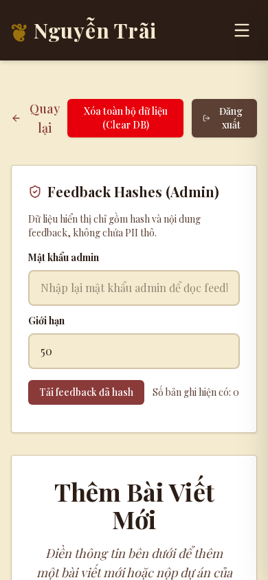
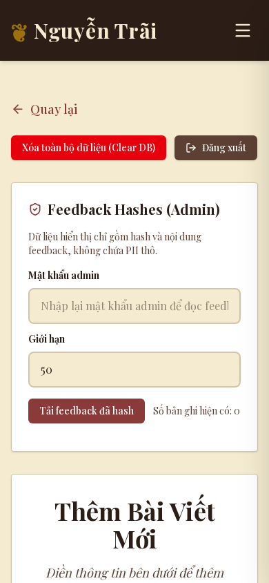
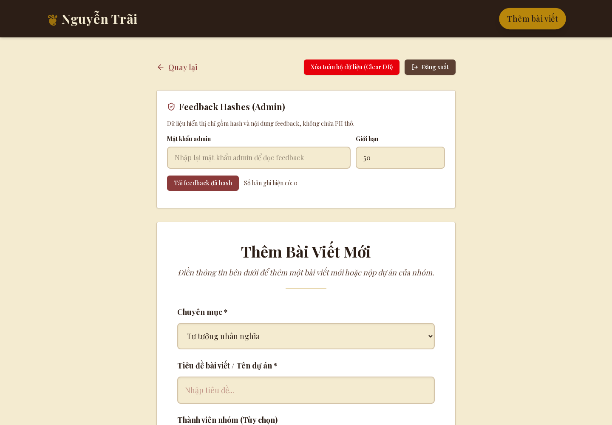

# P2 admin sections validation

Branch: `refactor/admin-sections`, based on the independently reviewed summary-removal branch at `b037912`. Local implementation only; no merge, push, deployment, environment change or production mutation.

## Scope and behavior

- `app/admin/page.tsx` owns the session check and shared save/delete pending state. The four admin sections mount only after a successful no-store `/api/admin/auth/status` response. Pending, rejected and offline checks never expose controls; rejected/offline checks redirect to login. The redundant client-mount state was removed; the regression mock deliberately follows the remaining auth state/effect.
- `ArticleForm` owns authored fields, validation, the existing deferred title-suggestion behavior and save payload. Label associations, save feedback and persistent failure messages were improved; failed saves preserve entered fields and uploaded media. The existing product and legacy/multiple-video payload formats remain intact.
- `MediaEditor` owns image ordering/removal and the existing Cloudinary/Mux upload paths. Mux uses a labelled native progress element driven by computable XHR bytes. Image status reports completed/total files and adds each successful image immediately. Errors stay visible until the next action. Existing image timeout/retry, Mux stall warning, visibility-based poll resume and poll backoff remain.
- Media cleanup now aborts in-flight XHR/image requests and clears polling/stall timers on unmount. Cancellation invalidates late upload-URL and asset-poll responses, preventing cancelled video operations from restoring an error or adding a video later. Before-unload warnings cover image uploads too.
- `FeedbackPanel` retains the explicit password recheck, limit clamp, hashed records and existing POST contract. Feedback loading/errors announce status without changing storage or server checks.
- `SecurityActions` retains exact typed bulk-delete confirmation and the server-returned JSON recovery download. The wording identifies that all articles are removed and that recovery requires the downloaded file. Save/delete pending state prevents competing content mutations. Logout behavior is unchanged.
- Native `ConfirmDialog` uses `showModal()` so the background is inert, focuses the safe cancel action, closes on Escape and restores the opener on cleanup. Shared `StatusMessage` exposes success/loading with `role=status` and failures with `role=alert`; no package or shared public styling changes.

All session/IP/origin/rate-limit enforcement remains in the existing server routes, which were not edited. No credentials, storage defaults, provider keys, AI endpoints or additional AI behavior were enabled. Existing title suggestions are unchanged and their provider-availability visibility remains a separate deferred decision.

## Automated evidence

The new `tests/admin-workflows.test.cjs` exercises real component handlers with mocked I/O:

1. Whitespace validation makes no request; failed save retains authored content.
2. Feedback requires a password, sends the existing password/limit contract and clears stale records on failure.
3. Bulk delete requires exact confirmation even if its handler is invoked directly, then downloads the returned deleted products with media preserved.
4. Cancellation during Mux URL preparation ignores the late response.
5. Real XHR byte progress reaches the native progress element; abort does not restore an upload error.
6. Unmount ignores a late ready-poll result.
7. Oversized image rejection performs no I/O; sequential image completions update counts and preserve successful uploads.
8. Shared mutation pending state disables save and clear controls.
9. Native dialog lifecycle opens modally, focuses cancel, handles Escape and closes/restores prior focus.

The existing `loading-ui` pending/rejected/offline/accepted auth cases were updated deliberately for the smaller page boundary. Existing server security/persistence/cache/summary-removal regressions remain part of the full suite.

Validation commands use Node 24 and the root checkout's installed dependencies through a temporary worktree symlink:

```sh
node --test tests/*.test.cjs
node node_modules/eslint/bin/eslint.js .
node node_modules/typescript/bin/tsc --noEmit
node /tmp/nguyentrai-p0-build.cjs /home/khoi/.codex/worktrees/675a/NguyenTrai-Porfolio
```

- Full tests: **92/92 passed**, including nine new admin workflow tests.
- Full lint/typecheck: **passed** after final source changes.
- Production build: **passed** with webpack, `PERSISTENCE_BACKEND=redis` and Redis/Neon/AI settings blank; no real provider/storage services. Expected missing-configuration warnings appeared. The temporary external `node_modules` symlink also causes standalone tracing warnings; this local output is not a release package.
- Desktop/mobile Playwright at 1440×1000 and 390×844: passed pending/rejected/offline/accepted auth; whitespace validation; failed save preserving content; successful save; hashed feedback read; synthetic image upload; byte progress, cancellation and ready processing for mocked Mux; exact deletion phrase, Escape/opener restoration, failed deletion, successful deletion and parsed JSON recovery download. All mutation/provider requests were intercepted locally. No uncaught page errors or initial horizontal overflow.
- Independent read-only review: no actionable findings; focused workflow/loading tests independently passed.
- Browser evidence: `/tmp/nguyentrai-p2-browser.json`, `nguyentrai-p2-admin-{1440,390}.png`, `nguyentrai-p2-confirm-{1440,390}.png`; harness `/tmp/nguyentrai-p2-browser.cjs` against the synthetic app on localhost:3340.

## Browser selectors and remaining review

Use `#article-title`, `#article-description`, `#article-section`, `#article-teamMembers`, `#article-fullDescription`, `#feedback-password`, `#feedback-limit`, `#clear-confirm`, `#admin-images`, `#admin-video`, `getByRole('progressbar', { name: 'Tiến độ tải video' })`, and upload buttons named `Chọn hình ảnh` / `Chọn video`. Status and error messages expose `status` and `alert` roles.

Browser gates above are complete for mocked local services. Real-provider error behavior remains covered only at the existing component/server boundaries; live provider uploads were not performed. Do not send these test mutations to production. Real Cloudinary/Mux/Redis/Neon integration calls and production behavior are outside this local UI validation.

Rollback is the scoped UI diff; no content migration or data rewrite is involved. The recovery download retains the existing browser-download semantics; this task does not add a restore UI. Native modal lifecycle has component regression coverage; Escape and opener restoration also passed in Chromium. Firefox/Safari were not exercised.

## GitHub review reconciliation

`review-admin-sections` is independently replayed on latest `origin/main` (`05638a4`, including merged roadmap #29). This focused branch deliberately includes neither P0 MiniSearch nor summary removal. Fresh branch validation passes **90 tests**, lint, typecheck and webpack build. The original 92-test snapshot above included the two P0b tests; the integrated source `b862a2f` had 99 tests. Counts differ by included suites, not failures. [Portable focused check receipts](review/ui-roadmap/results/).

Synthetic read-only before/after captures use main versus this focused admin source, identical mocked accepted authentication, no form mutations, and settled finite animations:

| Viewport | Before | After |
| --- | --- | --- |
| 390×844 |  |  |
| 1440×1000 |  |  |

[Clear-all confirmation](review/ui-roadmap/screenshots/admin-confirm-390.png) is synthetic; no production mutation was performed. Existing workflow evidence above covers error/recovery states, byte progress and cancellation.

Merge-tree simulation finds no conflicts against either original P0 branch (`f79e574`, `b037912`). This PR can be reviewed against main independently. `vercel.json` disables automatic deployments only for the named review branches; main/runtime settings remain unchanged. No merge or deployment is authorized. P4 remains deferred. The unchanged third-party attribution contrast limitation (2.06–2.1:1) is documented in the separate P3 audit; it is not introduced by the admin extraction.
